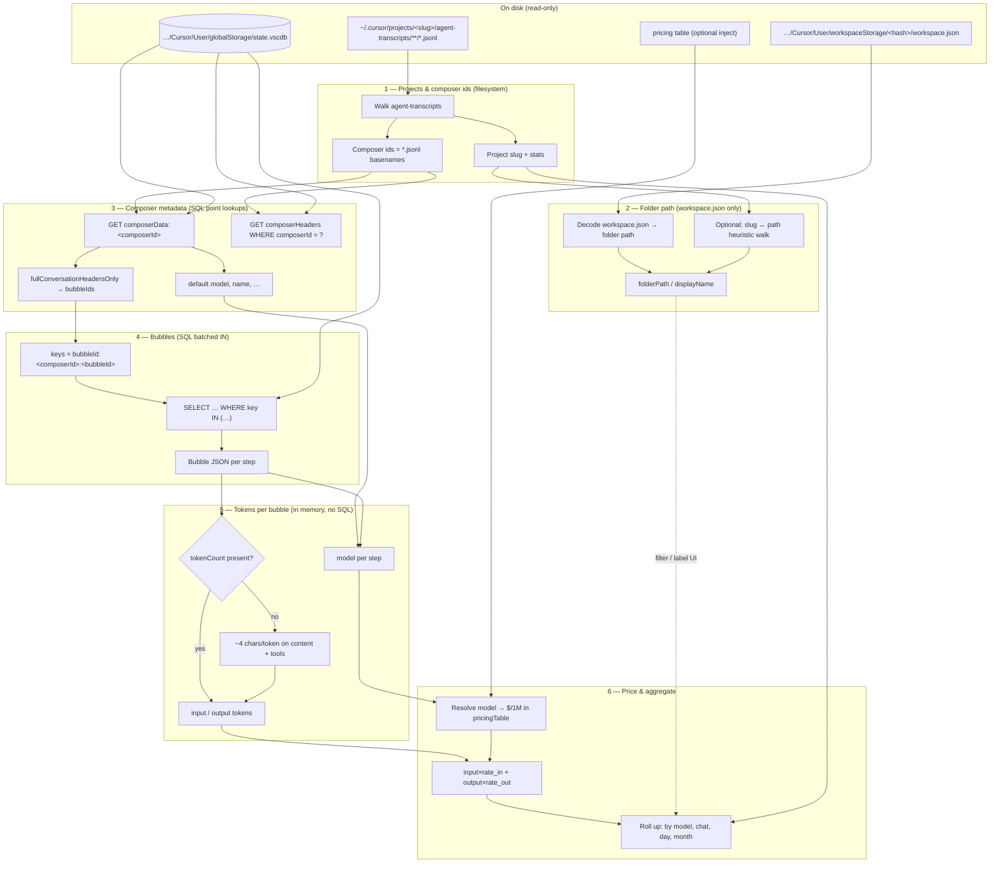

# agent-spend-cursor-data-access

Read Cursor’s local agent data on this machine (transcripts + `state.vscdb`) and produce token rollups. Used by [Agent Spend](../agent-spend).

**Pricing is injected — never loaded inside a scan.** `tokensFromComposerDb`, `tokensFromComposerDbBatch`, and `buildProjectUsagePayload` throw if `pricingTable` is missing. The table is any object with a `models` map (`{ currency?, note?, models: { [id]: { input, output } } }`); the library does not care where you got it.

We optionally ship a default table (`loadDefaultPricingTable()`, export `pricing.json`) so hosts can pass rates without wiring their own file first. Agent Spend resolves overrides in the app layer, then injects the same way:

```js
import {
  tokensFromComposerDbBatch,
  buildProjectUsagePayload,
  loadDefaultPricingTable,
} from 'agent-spend-cursor-data-access'

// Rates go stale fast and are not historically accurate by period.
// You are responsible for injecting pricing that matches the time range you care about.
const pricingTable = loadDefaultPricingTable() // or JSON.parse(fs.readFileSync('…', 'utf8'))

const rollup = await tokensFromComposerDbBatch(db, composerIds, { pricingTable })
const payload = buildProjectUsagePayload(slug, agentChats, rollup, { pricingTable, diskScanMs, dbOpenMs })
```

Requires Node **22.13+** (`node:sqlite`).

## Data flow

High-level pipeline for turning **local Cursor files** into **estimated spend**. Steps 1–5 live in this package; **Agent Spend** (Next.js UI) depends on it; **pricing** (step 6) stays in the app.

### Where data lives

| Step | Store | Windows path (typical) |
| --- | --- | --- |
| 1 | Filesystem | `%USERPROFILE%\.cursor\projects\<slug>\agent-transcripts\` |
| 2 | Filesystem | `%APPDATA%\Cursor\User\workspaceStorage\<hash>\workspace.json` |
| 3–4 | **SQLite (read-only)** | **`%APPDATA%\Cursor\User\globalStorage\state.vscdb`** |
| 5 | *(none — in memory)* | Bubble JSON already loaded in step 4 |
| 6 | Injected by host app | default or override `pricing.json` → `pricingTable` |

All composer and bubble **SQL** is steps **3 and 4** only, against `state.vscdb`. Step **5** does not open the database; it reads fields from the bubble objects returned in step 4. `workspaceStorage` is step **2** only (path labels).

### Pipeline (6 steps)

1. **Scan agent transcripts → projects and composer ids**  
   Walk `~/.cursor/projects/<slug>/agent-transcripts/**/*.jsonl`.  
   Each `<slug>` directory with transcripts is one **project**. Each `*.jsonl` file is one **agent chat**; the **composer id** is the filename without `.jsonl` (UUID).  
   Transcripts are the **catalog of which chats exist** (and source titles / user prompts for the UI). They are **not** the source of per-step token counts for spend rollups.

2. **Resolve slug → workspace folder path (labels only)**  
   Read `…/Cursor/User/workspaceStorage/<hash>/workspace.json` and decode the `folder` / `workspace` URI to a real path; match that path to the project slug (plus an optional filesystem walk if workspace metadata is missing).  
   This step **does not** discover composers, bubbles, or tokens. It only supplies **folder path / display name** for the UI and filters.

3. **Composer metadata — SQL on `state.vscdb` (point lookups, not a scan)**  
   Open `%APPDATA%\Cursor\User\globalStorage\state.vscdb` read-only (same file for macOS/Linux under Cursor’s `User/globalStorage/`).  
   For each **composer id from step 1**, fetch by exact key:
   - `cursorDiskKV`: `key = 'composerData:<composerId>'`
   - optionally `composerHeaders`: `composerId = ?` (display name on newer builds)  
   Composer ids are **never** enumerated from SQLite; they always come from step 1.

4. **Bubbles — same DB, SQL batched point lookups**  
   Still on **`state.vscdb`** (keep the same read-only connection from step 3).  
   From `composerData.fullConversationHeadersOnly[]`, collect each step’s `bubbleId`.  
   Fetch bubble JSON with batched **`IN`** queries on `cursorDiskKV`:  
   `key IN ('bubbleId:<composerId>:<bubbleId>', …)` (chunked, exact keys only).

5. **Input / output tokens per bubble (no SQL)**  
   Pure computation on the bubble JSON from step 4 — **no further reads** of `state.vscdb` or `workspaceStorage`.  
   Use Cursor’s `tokenCount.inputTokens` / `outputTokens` when present; otherwise estimate ~**4 characters per token** from user text vs assistant text + thinking + code blocks + tool payloads.  
   Attach **model** from the bubble when set, else the composer default from step 3.

6. **Price and roll up (app inject)**  
   Agent Spend resolves override → local `server/pricing.json` → package default, then passes **`pricingTable`**. Scan APIs in this package never read files themselves.  
   For each model: `spend = input × (input $/1M) + output × (output $/1M)` (exact model id match). Aggregate by model, chat, calendar day, and month.

### Data flow diagram



### Key paths (Windows example)

| Role | Path |
| --- | --- |
| Agent transcripts | `C:\Users\<you>\.cursor\projects\<slug>\agent-transcripts\` |
| Workspace metadata (step 2) | `C:\Users\<you>\AppData\Roaming\Cursor\User\workspaceStorage\<hash>\workspace.json` |
| **`state.vscdb` — composers (step 3) & bubbles (step 4)** | `C:\Users\<you>\AppData\Roaming\Cursor\User\globalStorage\state.vscdb` |
| Step 5 | *(uses bubble JSON from step 4; no file or SQL)* |

Env overrides (for tests / copied data): `AGENT_SPEND_CURSOR_USER_DIR`, `AGENT_SPEND_CURSOR_HOME_DIR`.

### Package split

```text
agent-spend-cursor-data-access    agent-spend (app)
(npm package)                     ─────────────────
─────────────────────────         Next.js UI
cursorPaths                       pricing.mjs + optional server/pricing.json (6)
pricing.json (default rates)
scan.mjs (1–2)                    api.mjs route handlers
stateDb.mjs (3–4)
bubbleTokens.mjs (5)
tokens.mjs + usageTimeline.mjs
```
